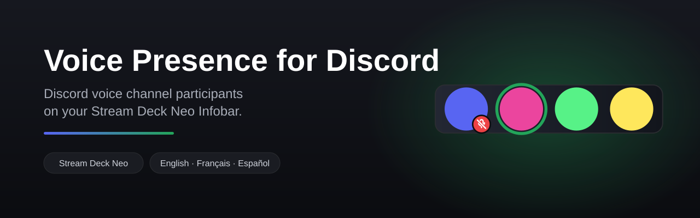

<p align="center">
  
</p>

**Voice Presence for Discord** is a Stream Deck plugin that shows the avatars of
everyone in your Discord voice channel on the **Stream Deck Neo Infobar**. It is
meant to be used alongside the **Discord plugin from Elgato**: Discord keeps its
mute, deafen, and join keys, while Voice Presence fills the Infobar.

Everything goes through Discord's local IPC RPC, so there is no bot, no account
token, and no screen scraping.

## Features

- **Participant avatars** on the Infobar — centered when they fit, scrolling
  beyond four people.
- **Speaking highlight** — a green ring around whoever is talking.
- **Mute and deafen badges** on each avatar.
- **Join, leave, and channel announcements** as short overlays.
- **Reminder veil** when *you* are muted or deafened.
- **Configurable background color** from the Property Inspector.
- Localized in **English**, **French**, and **Spanish**.

## Requirements

| Item | Detail |
| --- | --- |
| OS | Windows 10 or later |
| Discord | Discord for Windows, running |
| Hardware | Stream Deck **Neo** (the Infobar) |
| Software | Stream Deck 7.6+ / SDK 3.0 |
| Discord | A one-time authorization |

## Installation

1. Install the plugin from the **Elgato Marketplace**, or from source:

   ```powershell
   cd plugin
   npm install
   npm run build
   npm run link
   ```

2. Drop the **Voice Channel (Infobar)** action on your Stream Deck Neo.
3. Press **Reconnect to Discord** once and approve Discord's authorization.

The background color can then be changed in the action's Property Inspector.

## How it works

| Piece | What we use |
| --- | --- |
| Neo Infobar | Customizable since **Stream Deck 7.6 / SDK 3.0**: `232 × 50 px` layout with `pixmap` / `text` items |
| Discord avatars | `GET_IMAGE` from the local RPC returns a `data:image/png;base64,...` directly |
| Participants | `GET_SELECTED_VOICE_CHANNEL` plus `VOICE_STATE_*` / `SPEAKING_*` events |
| Authorization | OAuth `rpc` scope, granted **once** |

Everything goes through Discord's **local IPC RPC** (`\\.\pipe\discord-ipc-0`).

## Development

```
prototype/   Phase 1 - validate the Discord side, outside Stream Deck
plugin/      Phase 2 - the Stream Deck plugin (SDK 3, Infobar actions)
```

The prototype is the **test bench**: it validates the Discord layer
(`npm run smoke`, `status`, `watch`, `preview`) and holds the `VoiceMonitor`
tests. The plugin is the published artifact. See
[`prototype/README.md`](prototype/README.md).

### Plugin commands

```powershell
cd plugin
npm install
npm run build          # writes <uuid>.sdPlugin/bin/plugin.js
npm run assets         # regenerates the Infobar layout and assets
npm run icons          # regenerates the PNG icons and checks the SVGs
npm run locales        # checks that fr.json and es.json match en.json keys
npm run validate       # validates the manifest and layout
npm run link           # installs the plugin in Stream Deck
npm run watch          # continuous build + plugin restart
npm run release        # build + assets + icons + locales + validation + pack
```

The plugin follows the author's other plugin conventions (`com.lucafeine.*`, SDK 3,
`Software.MinimumVersion` 7.6, rollup).

> **`sharp` cannot be bundled** in the plugin: it is a native module, and Stream
> Deck runs a single JavaScript bundle. It stays a devDependency, used only to
> generate icons and the local preview. The Infobar itself is rendered by the
> layout engine and static assets.

## Icons

The icon set is the only visual asset kept in the repository:

| Item | Format |
| --- | --- |
| Plugin icon | PNG `256 × 256` and `512 × 512` (`icon.png`, `icon@2x.png`) |
| Category icon | SVG `28 × 28`, white `#FFFFFF`, transparent background |
| Action icons | SVG `20 × 20`, white `#FFFFFF`, transparent background |
| Key icons | SVG `72 × 72` |

`npm run icons` verifies the nominal dimensions and the monochrome rule, then
regenerates the plugin icon PNGs.

## Localization

The plugin is localized in **English**, **French**, and **Spanish**: `en.json`,
`fr.json`, and `es.json` cover the manifest, the Infobar text, and the Property
Inspector. English is the fallback for every other language, and the Property
Inspector follows the Stream Deck application language when it is available.

`npm run locales` checks before packaging that every listed language exposes
exactly the same keys as `en.json`, and that the author and name match the
manifest. The shipped languages are declared in
[`plugin/marketplace/metadata.json`](plugin/marketplace/metadata.json).

## Known limitations

- Only the channel **you** are connected to is visible (`GET_SELECTED_VOICE_CHANNEL`).
- The Infobar is **display-only**: there is no touch interaction.
- A layout is a **discrete** render: no smooth scrolling, only a step carousel.
- An OAuth token expires (~7 days); refresh is handled.
